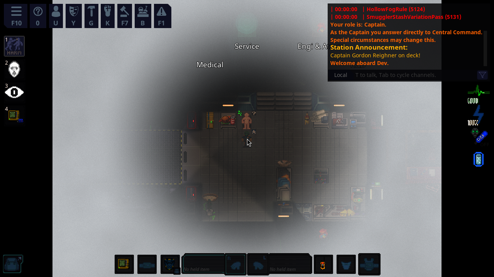
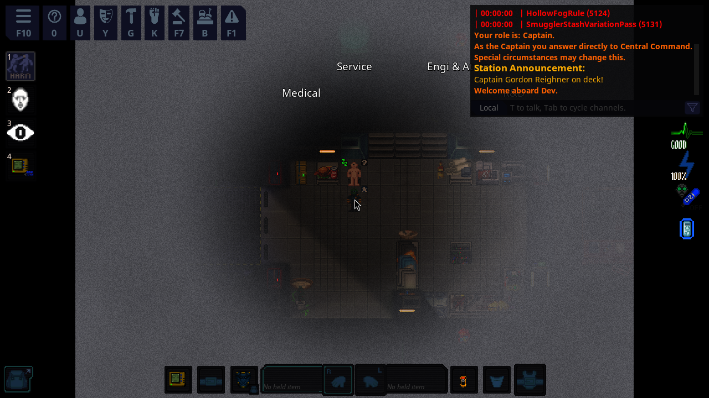
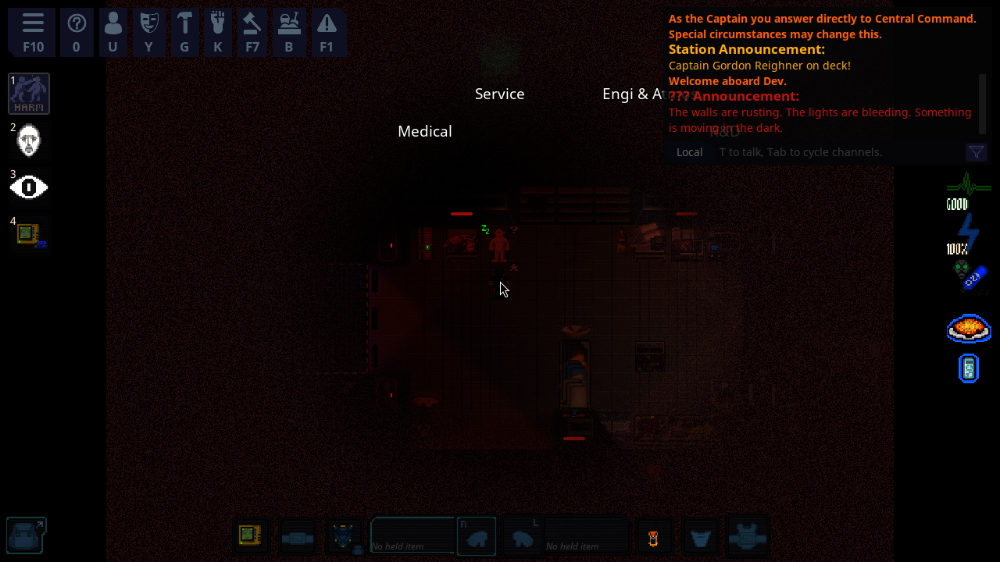

# Hollow Fog: a Silent Hill-style game mode for Space Station 14

A fog has swallowed the station. Every so often a siren starts to wail, the lights stutter and bleed
red, and the station slips into the **Otherworld**: dark, grainy and full of things that weren't there
a minute ago. When the siren stops, the fog rolls back in and the creatures dissolve. Until next time.

| Fog | Siren | Otherworld |
|---|---|---|
|  |  |  |

*Screenshots from the real game client running the mode on the Dev map.*

## What's in it

- **Hollow Fog game preset** (`hollow`). It shows up in the game-mode vote, or start it with `setgamepreset hollow`.
- **Fog overlay.** Drifting fog around every player, clear right around you and thick past a few tiles.
  Ghosts and observers aren't affected.
- **The cycle.** 8–14 minutes of fog, then a 25-second siren while every light on the station blinks,
  then 4 minutes of Otherworld, then back to fog. Each Otherworld shift spawns more monsters than the last.
- **Otherworld.** Every light bulb on the station turns blood red, the fog goes black and grainy, and
  monsters spawn around the station (about 0.75 per living player, between 3 and 30). Anything still
  alive dissolves when the fog returns.
- **Monsters:**
  - *faceless husk*: slow and tough, the most common.
  - *rust crawler*: fast and fragile.
  - *the Warden*: rare (5%), huge, slow, and hits like a truck.
- **Pocket radio.** Every crew member spawns with one. It hisses with static when a monster is within
  12 tiles, louder and faster the closer it gets. Use it in hand to switch it off if you need to hide quietly.
- **Original sounds.** The air raid siren and radio static were synthesized for this mod
  (`tools/generate_audio.py`) and are CC0. No audio or art from Silent Hill is used; the monsters
  reuse SS14's own flesh-creature sprites, recolored.

## Installing

You need the [.NET 10 SDK](https://dotnet.microsoft.com/download) and Python 3, the same as for SS14 itself.

```bash
git clone https://github.com/njaysimmons-ai/Shadows-of-the-Fortress
cd Shadows-of-the-Fortress
scripts/install.sh            # clones SS14 into ./ss14 and copies the mod in
cd ss14
python3 RUN_THIS.py
dotnet build
```

Already have an SS14 fork? Run `scripts/install.sh /path/to/your/fork` instead. The mod only adds files
under `_Hollow` folders, so it won't overwrite anything. It was built and tested against upstream commit
`bc6e67f75db2` (October 2026).

## Playing and testing

Start a server and client (`runserver.sh` / `runclient.sh` in the SS14 folder), then in the server
console or as an admin:

```
setgamepreset hollow
restartroundnow
```

Admins can skip to the next phase at any time (needs the `Fun` admin flag):

```
hollowadvance
```

It's also an ordinary game rule, so `addgamerule HollowFogRule` drops it into a round that's
already running. Anyone already on the station gets a radio.

## Tuning

All the numbers live on the `HollowFogRule` entity in `mod/Resources/Prototypes/_Hollow/game_rules.yml`:

| Field | Default | What it does |
|---|---|---|
| `minFogDuration` / `maxFogDuration` | `480` / `840` (seconds) | Time between Otherworld shifts |
| `sirenDuration` | `25` | How long the siren warns you |
| `otherworldDuration` | `240` | How long each Otherworld shift lasts |
| `monstersPerPlayer` | `0.75` | Spawns per living player |
| `minMonsters` / `maxMonsters` | `3` / `30` | Spawn count limits |
| `escalationPerShift` | `2` | Extra spawns for each shift already survived |
| `monsters` | husk / crawler / Warden | Weighted spawn table |
| `otherworldLightColor` | `#d0402a` | Bulb color in the Otherworld |
| `starterItem` | `HollowPocketRadio` | Item every crew member spawns with (set to `null` to disable) |

The fog's look (color, radius, grain) for each phase is in `FogLook` in
`mod/Content.Client/_Hollow/HollowFogOverlay.cs`.

## Layout

```
mod/                    Files copied into the SS14 checkout, mirroring its folder structure
  Content.Shared/_Hollow    Networked phase component, monster marker
  Content.Server/_Hollow    Game rule, static radio, hollowadvance command
  Content.Client/_Hollow    Fog overlay
  Content.IntegrationTests/Tests/_Hollow   Full-round tests
  Resources/...             Prototypes, shader, sounds, localization
scripts/install.sh      Copies mod/ into an SS14 checkout
tools/generate_audio.py Regenerates the siren and static sounds
```

## Tests

`HollowFogRuleTest` starts a real round on the Dev map and checks the whole cycle: fog on the map
(server and client), radio in the player's pocket, lights blinking during the siren, bulbs turning red
and monsters spawning in the Otherworld, then everything restored when the fog returns. A second test
checks that the radio picks up a nearby monster. SS14's own `AllGamePresetsStartTest` also picks up the
new preset automatically.

```bash
cd ss14
dotnet test Content.IntegrationTests --filter "FullyQualifiedName~HollowFog"
```
